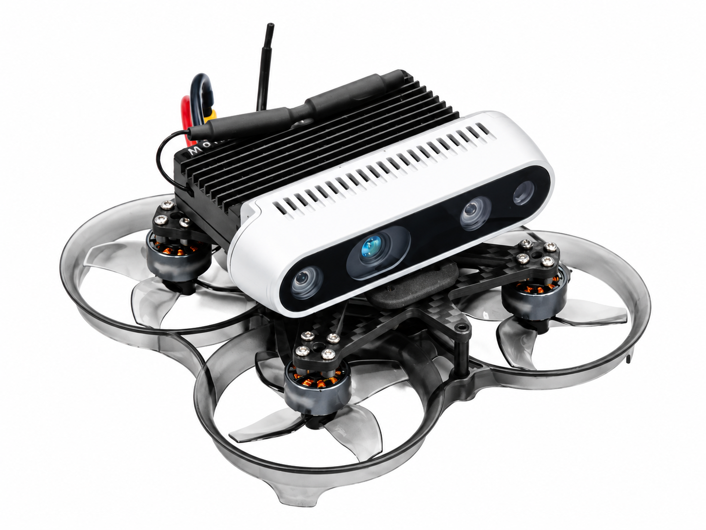
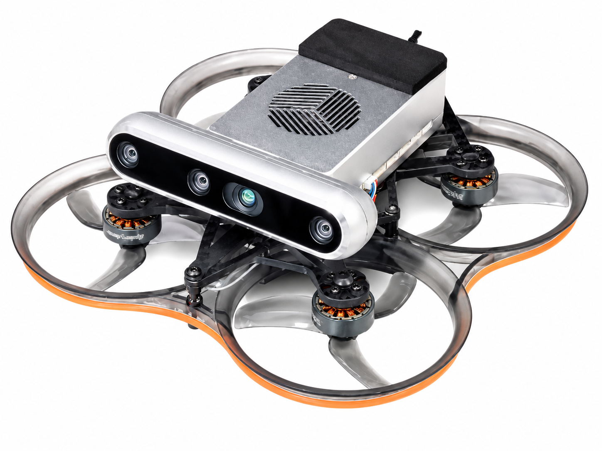
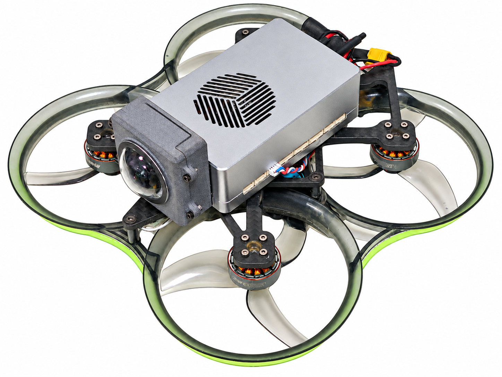
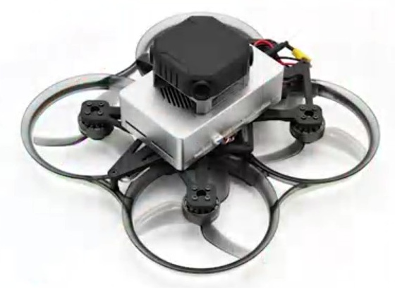
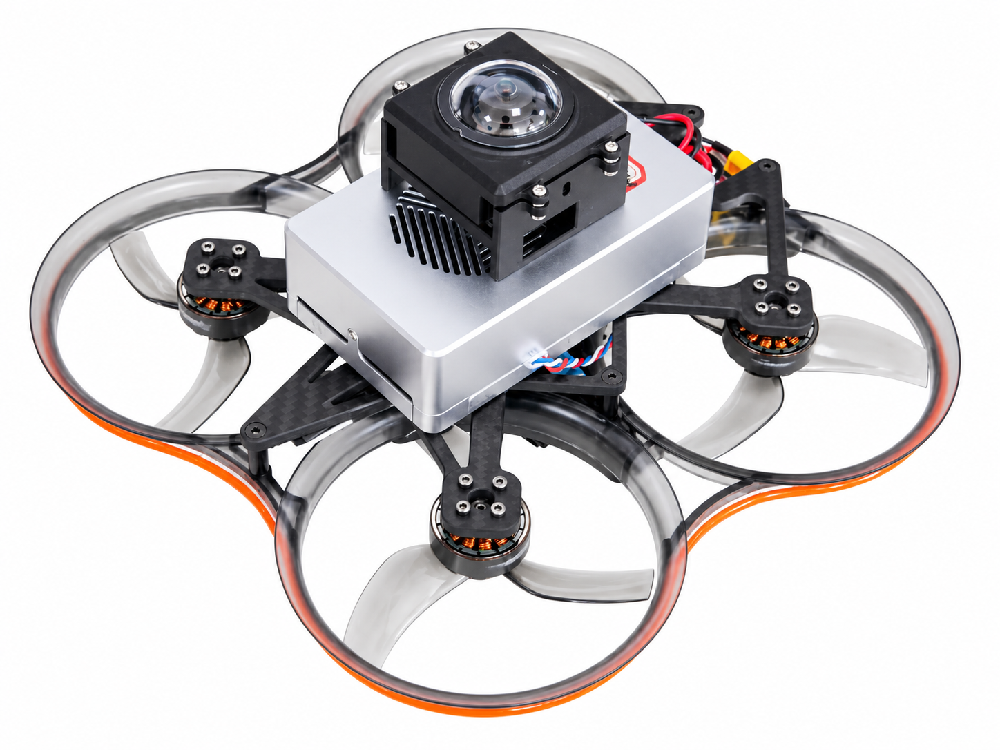
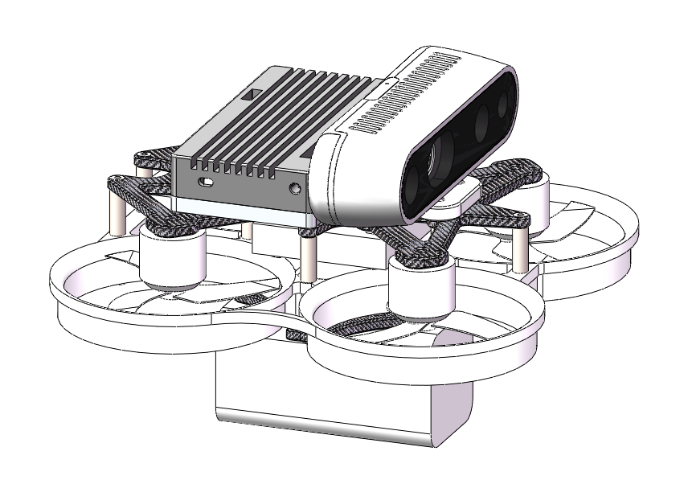
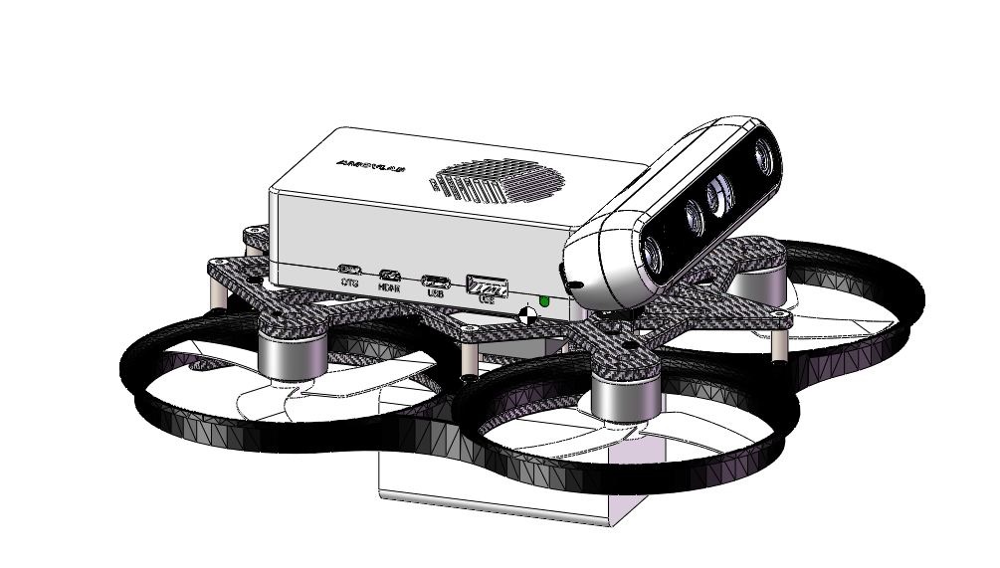
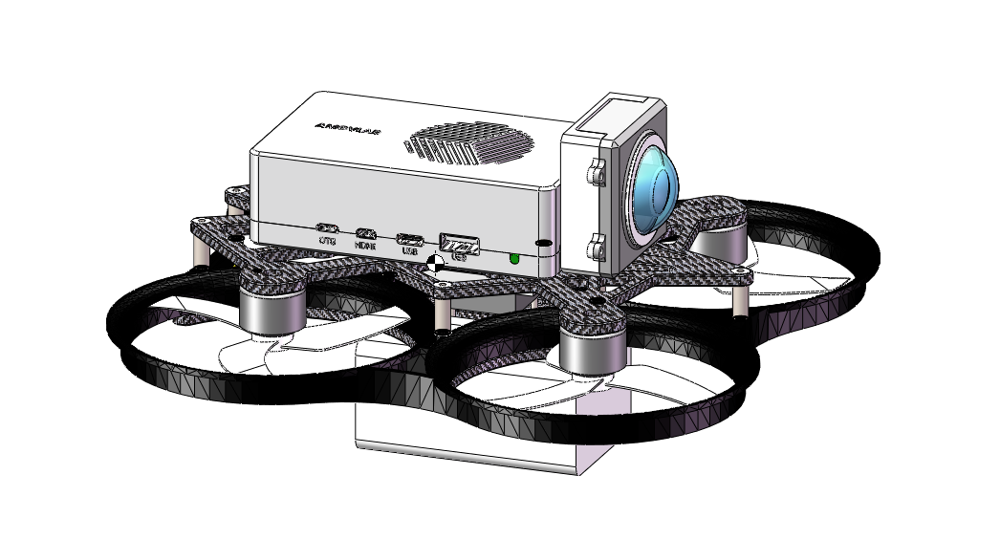
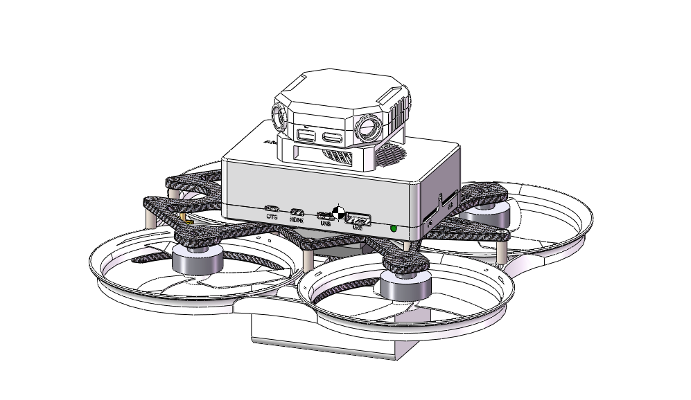
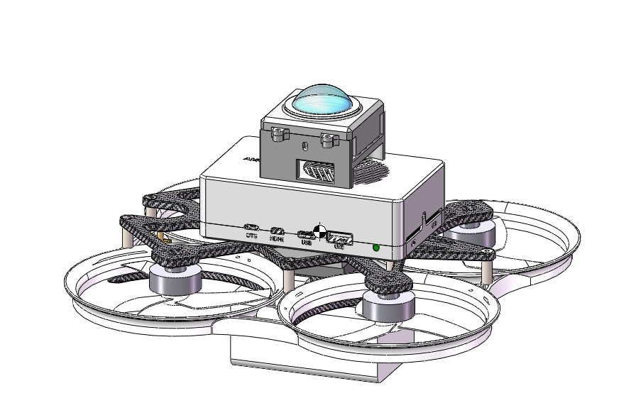

# 🚁 AeroForge｜无人机结构设计

[🌐 个人主页](https://mioulo.github.io/)

[简体中文](README.md) | [English](README.en.md)

飞机的结构设计与实物参考。零件布置仅展示一种可行的装配方案。

> ⚠️ 不同机载电脑布局对应的碳板不同，选用时请注意匹配。

    

📦 总装、碳板与打印件按飞机分别打包，统一放在本仓库 [Releases](https://github.com/Mioulo/AeroForge/releases)。

## 🪶 2.5 寸紧凑型

 &nbsp; 

<table align="center">
  <tr><th align="left">相机配置</th><td width="360">Intel RealSense D435深度相机</td></tr>
  <tr><th align="left">机载电脑</th><td width="360">LubanCat Zero W（rk3566）</td></tr>
  <tr><th align="left">飞控型号</th><td width="360">Micoair H743V2 AIO 45A</td></tr>
  <tr><th align="left">电调型号</th><td width="360">Micoair H743V2 AIO 45A</td></tr>
  <tr><th align="left">电机</th><td width="360">OddityRC 1205 5500KV</td></tr>
  <tr><th align="left">电池</th><td width="360">格式 4s 850mAh 120C</td></tr>
</table>

## 📷 3.5 寸 · 后置电脑 / 深度相机

 &nbsp; 

<table align="center">
  <tr><th align="left">相机配置</th><td width="360">Intel RealSense D455深度相机</td></tr>
  <tr><th align="left">机载电脑</th><td width="360">AMOVLAB Nidia Orin NX 16g</td></tr>
  <tr><th align="left">飞控型号</th><td width="360">Micoair NxtPX4V2</td></tr>
  <tr><th align="left">电调型号</th><td width="360">HobbyWing 45A</td></tr>
  <tr><th align="left">电机</th><td width="360">OddityRC 2006 2150KV</td></tr>
  <tr><th align="left">电池</th><td width="360">格式 6s 1300mAh 95C</td></tr>
</table>

## 👁️ 3.5 寸 · 后置电脑 / 前向单目

 &nbsp; 

<table align="center">
  <tr><th align="left">相机配置</th><td width="360">杰瑞微通DCXG20030 1.4mm 210°fov</td></tr>
  <tr><th align="left">机载电脑</th><td width="360">AMOVLAB Nidia Orin NX 16g</td></tr>
  <tr><th align="left">飞控型号</th><td width="360">Micoair NxtPX4V2</td></tr>
  <tr><th align="left">电调型号</th><td width="360">HobbyWing 45A</td></tr>
  <tr><th align="left">电机</th><td width="360">OddityRC 2006 2150KV</td></tr>
  <tr><th align="left">电池</th><td width="360">格式 6s 1300mAh 95C</td></tr>
</table>

> 💡 相机选型仅供参考，可根据实际需求选择针孔或鱼眼相机及对应的视场角（FOV）。

## 🧭 3.5 寸 · 中置电脑 / 全向深度

 &nbsp; 

<table align="center">
  <tr><th align="left">相机配置</th><td width="360">视元Seeker omni-d</td></tr>
  <tr><th align="left">机载电脑</th><td width="360">AMOVLAB Nidia Orin NX 16g</td></tr>
  <tr><th align="left">飞控型号</th><td width="360">Micoair NxtPX4V2</td></tr>
  <tr><th align="left">电调型号</th><td width="360">HobbyWing 45A</td></tr>
  <tr><th align="left">电机</th><td width="360">OddityRC 2006 2150KV</td></tr>
  <tr><th align="left">电池</th><td width="360">格式 6s 1300mAh 95C</td></tr>
</table>

## 🌐 3.5 寸 · 中置电脑 / 全景鱼眼

 &nbsp; 

<table align="center">
  <tr><th align="left">相机配置</th><td width="360">杰瑞微通DCXG20030 1.4mm 210°fov</td></tr>
  <tr><th align="left">机载电脑</th><td width="360">AMOVLAB Nidia Orin NX 16g</td></tr>
  <tr><th align="left">飞控型号</th><td width="360">Micoair NxtPX4V2</td></tr>
  <tr><th align="left">电调型号</th><td width="360">HobbyWing 45A</td></tr>
  <tr><th align="left">电机</th><td width="360">OddityRC 2006 2150KV</td></tr>
  <tr><th align="left">电池</th><td width="360">格式 6s 1300mAh 95C</td></tr>
</table>

> 💡 相机选型仅供参考，可根据实际需求选择针孔或鱼眼相机及对应的视场角（FOV）。

## 🧠 算法应用

这些飞机平台用于以下算法的实机研究与验证：

- [GeoMonoPlan](https://github.com/TJU-Aerial-Robotics/GeoMonoPlan)
- [YOPO](https://github.com/TJU-Aerial-Robotics/YOPO)
- [YOPOv2-Tracker](https://github.com/TJU-Aerial-Robotics/YOPO-Tracker)

## 📄 许可协议

本仓库原创设计文件、图片与文档采用 [MIT 许可](LICENSE) 发布。第三方内容保留各自的权利与许可。
